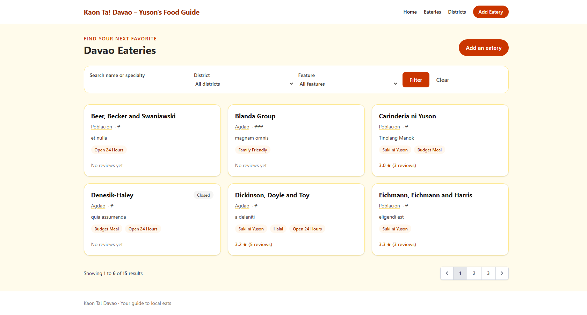
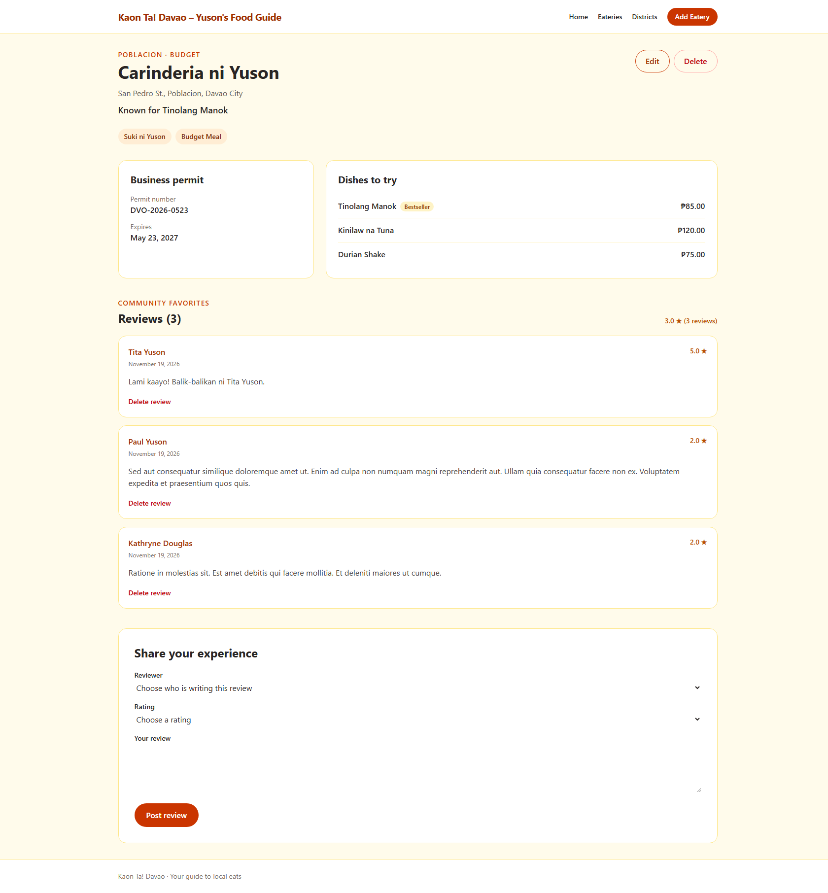
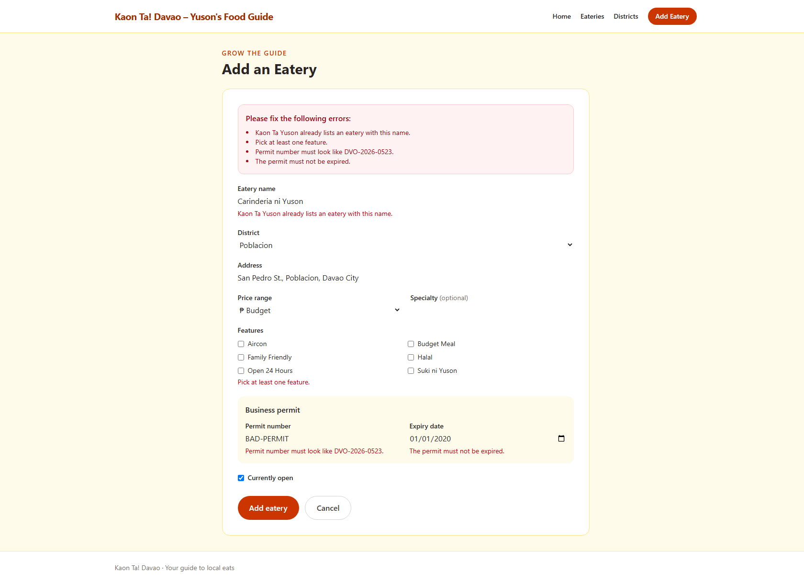

# Kaon Ta! Davao – Yuson's Food Guide

**Author:** Paul Yuson

**Project:** Public guide to Davao eateries, their permits, dishes, features, and resident reviews.

## Setup

From the project directory, run:

```sh
composer install
cp .env.example .env
php artisan key:generate
touch database/database.sqlite
php artisan migrate:fresh --seed
npm install
npm run build
php artisan serve
```

PowerShell equivalent for preparing the SQLite file:

```powershell
if (!(Test-Path 'database\database.sqlite')) {
    New-Item -ItemType File -Path 'database\database.sqlite' | Out-Null
}
```

Open the URL printed by `php artisan serve`. The application uses the SQLite connection configured by Laravel. The current Composer manifest targets Laravel 13.

## Personalized seed data

- **Districts:** Poblacion, Talomo, Agdao, Buhangin, Toril, Tugbok
- **Features:** Suki ni Yuson, Budget Meal, Halal, Open 24 Hours, Aircon, Family Friendly
- **Seeded reviewers:** Paul Yuson (`yuson@kaonta.test`) and Tita Yuson (`tita.yuson@kaonta.test`); both use `kaonta2026` as their seeded password. Ten additional users are generated by the factory.
- **Personal eatery:** Carinderia ni Yuson (`carinderia-ni-yuson`), Poblacion, San Pedro St., Poblacion, Davao City; budget; Tinolang Manok.
- **Permit:** DVO-2026-0523, expiring May 23, 2027.
- **Dishes:** Tinolang Manok (₱85.00, bestseller), Kinilaw na Tuna (₱120.00), and Durian Shake (₱75.00).

## Eloquent relationships

| Relationship | Type | Why this type fits |
| --- | --- | --- |
| District → eateries | `hasMany` | A district can list several eateries. |
| Eatery → district | `belongsTo` | Each eatery is assigned to one district. |
| Eatery → dishes | `hasMany` | One eatery can offer multiple dishes. |
| Dish → eatery | `belongsTo` | Each dish belongs to the eatery that serves it. |
| Eatery → reviews | `hasMany` | An eatery can receive reviews from many residents. |
| Review → eatery | `belongsTo` | Each review describes one eatery. |
| User → reviews | `hasMany` | A reviewer can write more than one review. |
| Review → user | `belongsTo` | Each review records one reviewer. |
| Eatery → permit | `hasOne` | Each eatery has one business permit on file. |
| Permit → eatery | `belongsTo` | The permit record points back to its eatery. |
| Eatery ↔ features | `belongsToMany` through `eatery_feature` | An eatery can have several features and each feature can describe several eateries. |
| District → reviews | `hasManyThrough` via eateries | Reviews for a district are reached through the eateries located there. |

## Routes

Output of `php artisan route:list --except-vendor`:

```text
 GET|HEAD / .. home › HomeController
 GET|HEAD districts .. districts.index › DistrictController@index
 GET|HEAD districts/{district} .. districts.show › DistrictController@show
 GET|HEAD eateries .. eateries.index › EateryController@index
 POST eateries .. eateries.store › EateryController@store
 GET|HEAD eateries/create .. eateries.create › EateryController@create
 GET|HEAD eateries/{eatery} .. eateries.show › EateryController@show
 PUT|PATCH eateries/{eatery} .. eateries.update › EateryController@update
 DELETE eateries/{eatery} .. eateries.destroy › EateryController@destroy
 GET|HEAD eateries/{eatery}/edit .. eateries.edit › EateryController@edit
 POST eateries/{eatery}/reviews .. eateries.reviews.store › ReviewController@store
 GET|HEAD reviewers/{user} .. reviewers.show › ReviewerController@show
 DELETE reviews/{review} .. reviews.destroy › ReviewController@destroy

 Showing [13] routes
```

## Screenshots

**Eatery list**



**Eatery page with reviews**



**Create form showing validation errors**


